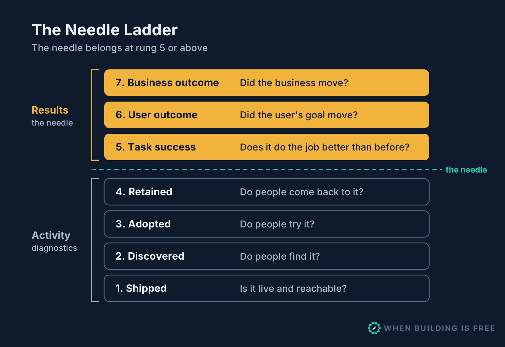

<p align="center">
  
</p>

# When Building Is Free

Product management for AI software factories. When agents make building nearly free, the hard work moves to deciding what to build, proving it worked, and knowing what to delete.

This repository holds the tools that go with the **When Building Is Free** newsletter by Barry Gervin. Everything here is open source and installable as agent skills.

## The series

| No. | Article | What it covers | Tools here |
|---|---|---|---|
| 1 | **Stop measuring PR velocity: The Needle Ladder** | Why PR velocity, time to merge and tokens burned are Goodhart traps; the Needle Ladder; every feature as a pre-registered bet with an expiry date | [`feature-charter`](plugins/feature-charter) skill, validator, CI gate, [examples](examples) |
| 2 | Triaging customer feedback at scale | Coming next | |

Article links are in [articles/](articles).

## The Needle Ladder



Rungs 1 to 4 are activity. Rungs 5 to 7 are results. A feature's needle belongs at rung 5 or above; usage, adoption and active users are diagnostics that explain why the needle did or didn't move.

## The `feature-charter` skill

The skill adds an **Outcome charter** section to the spec you already use: a PRD, GitHub issue, user story, [Spec Kit](https://github.com/github/spec-kit) spec or RFC. It doesn't replace your template, restructure your document or delete what you wrote. It:

1. Sorts the spec's existing success metrics by rung and labels the activity ones as diagnostics.
2. Adds two plain sentences (the bet, and how you'll know) and a small `feature-charter` block that agents and CI can check.
3. Gates builds on an approved charter, keeps builder and judge separate, and locks the bet once it's approved.
4. Runs the keep, iterate or sunset review on the expiry date, and tracks removal.

```feature-charter
id: FC-042
status: approved
owner: Head of Product
builder: factory/build-agents
judge: factory/eval-agent
approved: 2026-08-17
hypothesis:
  we_believe: automatic payment reminders before and after the due date
  for: office managers at contractors sending 20+ invoices a month
  will_result_in: invoices paid sooner
  because: most late payments are forgotten, not disputed
needle:
  name: Median days from invoice sent to paid
  rung: user_outcome
  definition: Median days from sent to paid for invoices sent in the first week; unpaid after 35 days count as 35
  source: invoice.sent and invoice.paid events
  baseline: 34
  target: 27
  direction: decrease
  min_change: 4
guardrails:
  - {name: Complaints about reminders, limit: no more than 1 per 100 sent}
evaluation:
  method: before_after
  review_date: 2026-09-30
  keep_if: drops by 4 days or more and guardrails hold
  kill_if: drops by less than 2 days, or a guardrail is breached
  iterate_if: drops by 2 to 4 days
  if_inconclusive: sunset
  look_at: interview 6 office managers
removal: {flag: invoice-reminders, code_paths: [src/reminders/], estimate_hours: 4}
```

## Install

### Claude Code

```text
/plugin install feature-charter --marketplace bgervin/when-building-is-free
```

That one step works in Claude Code 2.1.275 or later. On older versions, add the marketplace first:

```text
/plugin marketplace add bgervin/when-building-is-free
/plugin install feature-charter@when-building-is-free
```

Or from a shell: `claude plugin marketplace add bgervin/when-building-is-free`, then `claude plugin install feature-charter@when-building-is-free`.

### GitHub Copilot CLI

```bash
copilot plugin marketplace add bgervin/when-building-is-free
copilot plugin install feature-charter@when-building-is-free
```

### GitHub Copilot in VS Code and Copilot coding agent

Copy the skill into your repository's `.github/skills/` folder:

```bash
git clone --depth 1 https://github.com/bgervin/when-building-is-free /tmp/when-building-is-free
mkdir -p .github/skills
cp -r /tmp/when-building-is-free/plugins/feature-charter/skills/feature-charter .github/skills/
```

### Other agents (Cursor, Codex, Gemini CLI and more)

```bash
npx skills add bgervin/when-building-is-free
```

## Use it

Ask your agent in plain language:

- "Add an outcome charter to `docs/specs/payment-reminders.md`."
- "Which of the success metrics in this PRD are activity, and which are results?"
- "FC-007's review date is today. Run the review."
- "Which features are overdue for review?"

The validator runs anywhere with Python 3.9+ and PyYAML. The paths below assume you copied the skill into `.github/skills/`. With a plugin install, ask your agent to run it; the skill tells it where the script is.

```bash
pip install pyyaml
python .github/skills/feature-charter/scripts/charter.py validate docs/                    # check every charter
python .github/skills/feature-charter/scripts/charter.py due docs/                        # overdue reviews, unremoved sunsets
python .github/skills/feature-charter/scripts/charter.py require FC-007 docs/             # is this charter approved and valid?
python .github/skills/feature-charter/scripts/charter.py require docs/ --text "$PR_BODY"  # every charter a PR mentions
```

## Before and after

Each example keeps the original spec and adds to it. Compare `before.md` with `after.md`.

| Example | Spec format | What it shows |
|---|---|---|
| [Payment reminders](examples/01-github-issue-payment-reminders) | GitHub issue | Activity metrics relabelled as diagnostics; a rung 6 needle shaped by a 45-day expiry date; the review six weeks later |
| [Suggested replies](examples/02-prd-suggested-replies) | PRD | An AI feature where "suggestions accepted" would be a Goodhart trap; an unmeasured baseline handled honestly; a holdback |
| [Invoice export](examples/03-user-story-invoice-export) | User story (Jira) | An insurance feature, valuable when needed rather than used often |
| [Onboarding checklist](examples/04-spec-kit-onboarding-checklist) | Spec Kit `spec.md` | Success criteria tagged by rung, a new result criterion added, and a charter for an agent-built feature |

The skill also covers RFCs and design docs; see its [snippets](plugins/feature-charter/skills/feature-charter/templates/snippets).

## This repository's own bet

The skill is held to its own rules. Its charter, [FC-001](charters/FC-001-feature-charter-skill.md), bets that charters lead to real decisions; stars and installs are diagnostics. The repository's weekly CI check fails if that review goes overdue.

## Sharing a charter story (optional)

After a review records a keep, iterate, sunset or removal decision, the skill may offer you a link to a pre-filled GitHub form for sharing an anonymized story of how the charter worked out. It's how I learn whether charters lead to real decisions, which is this skill's own needle.

- The agent shows you exactly what the link contains: the decision, the needle's rung, the spec format and two or three sentences with no names or numbers.
- Nothing is sent unless you open the link and submit the form yourself. The agent never submits it.
- It's offered once per decision. Turn it off with `story_prompt: false` in `.feature-charter.yml`.
- The skill sends no telemetry of any kind.

## Enforce it in CI

Copy [`charter-gate.yml`](plugins/feature-charter/skills/feature-charter/assets/charter-gate.yml) into `.github/workflows/`. On pull requests it validates changed charters and blocks edits to an approved bet without an approved amendment. On pull requests labelled `feature` it requires an approved charter. Every Monday it lists overdue reviews and features sunset but never removed.

Defaults (45 days to first review, 90 days per renewal) can be changed in a [`.feature-charter.yml`](plugins/feature-charter/skills/feature-charter/templates/feature-charter.config.yml) at your repository root.

## Principles

1. **Enrich, don't replace.** Your spec format stays. The charter is one added section.
2. **The needle is a result.** Rung 5 or higher. Usage, adoption and active users are diagnostics.
3. **Write the rules before the data arrives.** The bet locks at approval; changes need a visible, approved amendment.
4. **Every bet expires.** Inconclusive never means keep, and keep is a renewal with its own review date.
5. **The builder never grades its own work.** A builder that can redefine its own needle will move the number without moving the outcome.
6. **Deletable by default.** Every feature ships behind a kill switch with a removal plan.

## Built on

- Rodden, Hutchinson and Fu, [HEART: user-centered metrics](https://research.google/pubs/pub36299/) (CHI 2010)
- Kohavi and colleagues on the Overall Evaluation Criterion and experiment success rates at Microsoft ([KDD 2009 tutorial](https://ai.stanford.edu/~ronnyk/2009-06-28KDDTutorialT4part1.pdf))
- Fabijan, Dmitriev, Olsson and Bosch, [The Evolution of Continuous Experimentation](https://exp-platform.com/Documents/2017-05%20ICSE2017_EvolutionOfExP.pdf) (ICSE 2017)
- Athey, Chetty, Imbens and Kang, [The Surrogate Index](https://www.nber.org/papers/26463)
- Manheim and Garrabrant, [Categorizing Variants of Goodhart's Law](https://arxiv.org/abs/1803.04585) (2018)

## Contributing

Issues and pull requests are welcome, especially before and after examples in spec formats not covered yet. See [CONTRIBUTING.md](CONTRIBUTING.md).

## License

[MIT](LICENSE)
