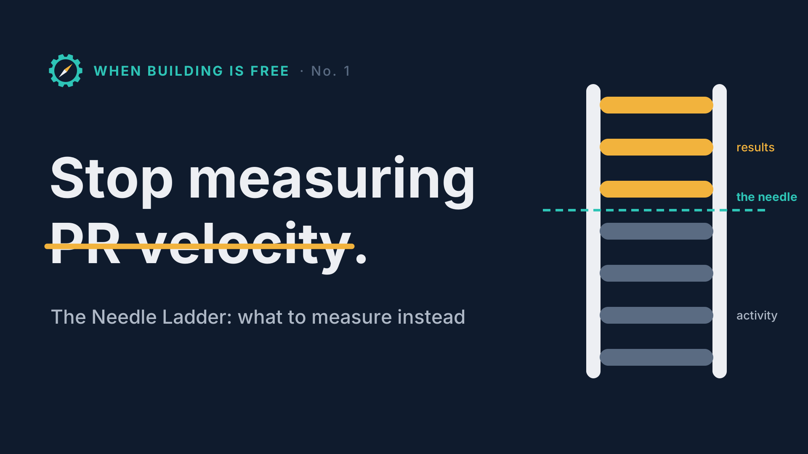

# Articles

The **When Building Is Free** newsletter, published on LinkedIn every two weeks.

| No. | Title | Published | Tools |
|---|---|---|---|
| 1 | Stop measuring PR velocity: The Needle Ladder | Link coming at publication | [feature-charter](../plugins/feature-charter), [examples](../examples) |
| 2 | Strategy before triage (working title) | Coming next | [feedback-triage](../plugins/feedback-triage), [example](../examples/05-strategy-and-triage) |
| 2 | Triaging customer feedback at scale | Coming next | |

